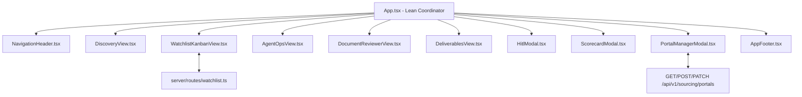

# Implementation Plan: App.tsx Modular Decomposition & Watchlist Kanban UI

Decompose the monolithic `App.tsx` (167 KB, ~3,200 lines) into clean, maintainable modular components under `src/components/`, secure secrets into `.env`, and implement the dedicated **Watchlist Kanban board** (`Discovered` → `Pre-Selected` → `Doc Ready` → `Applied`) connected to the Swiss Portal Manager.

---

## User Review Required

> [!IMPORTANT]
> **API Key Hardening**: Live API keys were detected inside `profiles/Twan.json` and `profiles/Dinda.json`. As part of Phase 1 hardening, these will be replaced with `"ENV:DASHSCOPE_API_KEY"`, `"ENV:GOOGLE_API_KEY"`, `"ENV:OPENROUTER_API_KEY"`, and `"ENV:OPENAI_API_KEY"` so all secrets are loaded exclusively from `.env`.

> [!NOTE]
> **Component Architecture**: `App.tsx` will remain the top-level state controller and coordinator, but all visual panels (`Discovery`, `WatchlistKanban`, `AgentOps`, `DocumentReviewer`, `Deliverables`) and sub-dialogs (`HitlModal`, `ScorecardModal`, `AppFooter`) will become standalone React components in `src/components/`.

---

## Proposed Changes

### 1. Secrets Hardening

#### [MODIFY] [profiles/Twan.json](file:///c:/Dev/JobAgentApply/profiles/Twan.json)
- Replace hardcoded plaintext API keys in the `models` list with `"ENV:..."` references matching `.env`.

#### [MODIFY] [profiles/Dinda.json](file:///c:/Dev/JobAgentApply/profiles/Dinda.json)
- Replace hardcoded plaintext API keys in the `models` list with `"ENV:..."` references matching `.env`.

---

### 2. Component Modularization (`src/components/`)

#### [NEW] [src/components/NavigationHeader.tsx](file:///c:/Dev/JobAgentApply/src/components/NavigationHeader.tsx)
- Extracts the top navbar with navigation pills:
  - `0. Discovery & Sourcing` (with unapplied badge counter)
  - `📋 My Watchlist` (with pre-selected badge counter)
  - `1. AgentOps Control`
  - `2. Document Review & Edition`
  - `3. Deliverables & Export`
- Includes theme switcher (Day/Night mode) and pipeline status indicator badges.

#### [NEW] [src/components/BearDeliveryAnimation.tsx](file:///c:/Dev/JobAgentApply/src/components/BearDeliveryAnimation.tsx)
- Extracts the animated Postman Bear SVG and progress indicators used during LaTeX compilation and asset generation.

#### [NEW] [src/components/AppFooter.tsx](file:///c:/Dev/JobAgentApply/src/components/AppFooter.tsx)
- Extracts the standard AFA Studio Swiss corporate footer with platform links, credentials, and GDPR badges.

#### [NEW] [src/components/HitlModal.tsx](file:///c:/Dev/JobAgentApply/src/components/HitlModal.tsx)
- Extracts the Human-In-The-Loop metadata review and editing modal (`SK-11 Enrichment` confirmation).

#### [NEW] [src/components/ScorecardModal.tsx](file:///c:/Dev/JobAgentApply/src/components/ScorecardModal.tsx)
- Extracts the strict fit scorecard modal (must-have vs. nice-to-have criteria, gap defenses, and interview talking points).

#### [NEW] [src/components/DiscoveryView.tsx](file:///c:/Dev/JobAgentApply/src/components/DiscoveryView.tsx)
- Extracts the full View 0:
  - Hero header with live metrics (*Total Discovered*, *Ready to Ingest*, *Previously Applied*, *Top Portals*).
  - Search and filter pills (All, New Only, Pre-Selected, High Fit $\ge 70\%$, Swiss portals).
  - Multi-profile Chrome history scanning, RAV 733-application historical database sync, and batch URL importer.
  - Job cards with 1-click **"Ingest & Apply"**, **"Pre-Select"**, and **"Générer Dossier"**.

#### [NEW] [src/components/WatchlistKanbanView.tsx](file:///c:/Dev/JobAgentApply/src/components/WatchlistKanbanView.tsx)
- Implements the dedicated **My Watchlist** Kanban board:
  - 4 workflow columns:
    1. 📥 **Discovered**: Inbox of newly detected opportunities.
    2. ⭐ **Pre-Selected**: Starred high-fit target roles queued for candidacy.
    3. 📄 **Doc Ready**: 14-agent dossier generated, awaiting human review.
    4. 🚀 **Applied**: Submitted applications logged in audit history.
  - Interactive features:
    - Drag / quick status transition buttons.
    - **Auto-Preselect** button ($\ge 75\%$ DNA match score threshold).
    - Quick launch into 14-agent dossier generation.
    - Direct link to Document Reviewer when dossier is compiled.
    - Favorite Portals button to open `PortalManagerModal`.
    - Real-time search and filter.

#### [NEW] [src/components/AgentOpsView.tsx](file:///c:/Dev/JobAgentApply/src/components/AgentOpsView.tsx)
- Extracts View 1:
  - Career Copilot guidance card.
  - Autonomous Ingestion Control card (Job URL, Raw text input, Profile selector, Language, Tone, Drafting engine selector, CV Matcher engine selector, Historical Fit boost toggle, Home origin for transit calculations).
  - 14-Agent DAG Flow visualization with live status icons, agent execution timers, and pulse animations.
  - Resizable Telemetry Console with SSE live stream viewer, orientation dock switcher, and log filtering.

#### [NEW] [src/components/DocumentReviewerView.tsx](file:///c:/Dev/JobAgentApply/src/components/DocumentReviewerView.tsx)
- Extracts View 2:
  - Multi-format Asset Catalog sidebar (PDF, MD, TEX, JSON).
  - Dual-mode stage:
    - Code & Markdown editor with word/line counts, modified status, and instant server background sync (`/api/v1/output/save`).
    - Structured visual card for `job_details_json`.
    - Live PDF preview iframe with zoom and page controls.
    - Re-compilation trigger for `SK-08 Compiler` on edited LaTeX.

#### [NEW] [src/components/DeliverablesView.tsx](file:///c:/Dev/JobAgentApply/src/components/DeliverablesView.tsx)
- Extracts View 3:
  - GDPR Sovereignty & Local Storage controls (Consent toggle, Article 17 local purge).
  - Final Application Dossier Package card with ATS match score and justification.
  - Swiss Transit & Strict Fit Scorecard (SBB timetable link, door-to-door commute minutes).
  - Primary download buttons (Cover Letter, CV, Merged Dossier PDF).
  - Cryptographic Verification & Audit Trail (SHA-256 fingerprint, ALCOA+ compliance log).

#### [MODIFY] [src/App.tsx](file:///c:/Dev/JobAgentApply/src/App.tsx)
- Refactor from ~3,200 lines to ~250 lines.
- Acts as the central state controller, holding the shared pipeline state and orchestrating view switching between:
  - `"discovery" | "watchlist" | "agentops" | "reviewer" | "deliverables"`.
- Wires all views and modals cleanly.

---

## Verification Plan

### Automated Tests
- Type checking: `npm run lint` (`tsc --noEmit`) to verify zero TypeScript errors across all decomposed components.
- Production build: `npm run build` (Vite client + esbuild Node server) to verify zero build errors.

### Manual Verification
- Start server with `npm run dev` and test:
  1. **Navigation**: Switch between Discovery, Watchlist, AgentOps, Reviewer, and Deliverables.
  2. **Watchlist Kanban**: Verify columns render, status changes persist to `/api/v1/sourcing/watchlist`, and "Auto-Preselect" updates jobs.
  3. **Portal Registry Modal**: Open modal, toggle a portal, verify list updates.
  4. **Pipeline Ingestion**: Ingest a sample URL, verify DAG telemetry and HITL modal open seamlessly.
  5. **Reviewer & Editor**: Verify deliverable asset editing, background server save, and PDF preview.
