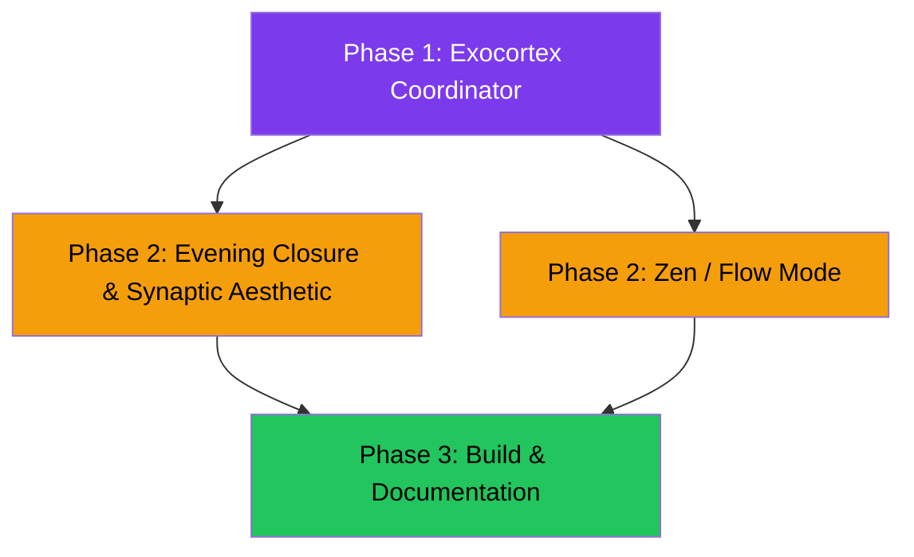

# Exocortex Roadmap: Gap Analysis & Phased Implementation Plan

Mapping every requirement in [`roadmap-neuroErgonomistdesign.md`](file:///c:/Dev/MemoryBlast/docs/roadmap-neuroErgonomistdesign.md) against the current MemoryBlast codebase to identify what's **already built**, what's **partially done**, and what's **new work**.

---

## Coverage Matrix

| Roadmap Requirement | Status | Current Module(s) | Gap / Work Needed |
|---|---|---|---|
| **Chromium Lifecycle** (CDP open/close, shelf-life, closure causes) | ✅ **Done** | [`chromium/lifecycle.rs`](file:///c:/Dev/MemoryBlast/src/chromium/lifecycle.rs), [`knowledge/tab_history.rs`](file:///c:/Dev/MemoryBlast/src/knowledge/tab_history.rs), [`knowledge/tab_analytics.rs`](file:///c:/Dev/MemoryBlast/src/knowledge/tab_analytics.rs) | — |
| **File Explorer Activity** (workspace dirs, project anchors, stale hoarding) | ✅ **Done** | [`explorer/watcher.rs`](file:///c:/Dev/MemoryBlast/src/explorer/watcher.rs), [`knowledge/explorer_history.rs`](file:///c:/Dev/MemoryBlast/src/knowledge/explorer_history.rs) | — |
| **Clipboard Intelligence** (copy frequency, snippet categorization, frustration loops) | ✅ **Done** | [`copilot/clipboard.rs`](file:///c:/Dev/MemoryBlast/src/copilot/clipboard.rs) | — |
| **Context Drift & Decay** (forgotten loops, working set ceiling) | ✅ **Done** | [`copilot/drift.rs`](file:///c:/Dev/MemoryBlast/src/copilot/drift.rs), [`copilot/fixation.rs`](file:///c:/Dev/MemoryBlast/src/copilot/fixation.rs) | — |
| **Continuous Behavioral Consolidation** (daily rollups, archetypes, adaptive thresholds) | ✅ **Done** | [`knowledge/consolidator.rs`](file:///c:/Dev/MemoryBlast/src/knowledge/consolidator.rs), [`knowledge/adaptive_engine.rs`](file:///c:/Dev/MemoryBlast/src/knowledge/adaptive_engine.rs) | — |
| **Morning "Where You Left Off" Briefing** | ✅ **Done** | [`knowledge/orientation.rs`](file:///c:/Dev/MemoryBlast/src/knowledge/orientation.rs) (CLI `brief` / `morning`) | — |
| **Context Parking (`Ctrl+Shift+F`)** (tabs + Explorer + clipboard → markdown) | ✅ **Done** | [`copilot/stashing.rs`](file:///c:/Dev/MemoryBlast/src/copilot/stashing.rs), [`copilot/anchor.rs`](file:///c:/Dev/MemoryBlast/src/copilot/anchor.rs) | — |
| **Synaptic Pulse Treemap** (breathing gradients, cognitive-state colors) | 🟡 **Partial** | [`treemap/mod.rs`](file:///c:/Dev/MemoryBlast/src/treemap/mod.rs) — layout engine exists | Need: dynamic color gradient tied to drift index |
| **Cognitive Load Visualizer** (real-time drift severity → UI color theme) | 🟡 **Partial** | [`notifications/badge.rs`](file:///c:/Dev/MemoryBlast/src/notifications/badge.rs) tracks `drift_severity` | Need: CSS transitions + SSE push to GUI |
| **Zero-Distraction Zen / Flow Mode** (suppress non-urgent alerts during >45m focus) | 🔴 **Not Started** | — | New: `copilot/flow_mode.rs` |
| **Evening Closure & Micro-Celebration** (daily wrap-up summary) | 🔴 **Not Started** | — | New: `knowledge/closure.rs` |
| **Exocortex Coordinator** (orchestration hub) | 🔴 **Not Started** | — | New: `copilot/exocortex.rs` |
| **Dark Mica & Flow Themes** (CSS theming reacting to cognitive state) | 🔴 **Not Started** | Static CSS exists in [`style.css`](file:///c:/Dev/MemoryBlast/src/gui/assets/style.css) | Need: CSS custom property transitions + JS theme controller |

---

## Phased Implementation Plan

### Phase 1: Exocortex Coordinator & Flow Mode *(Foundation)*

> [!IMPORTANT]
> This is the keystone — the orchestration hub that wires together all existing engines into one unified feedback loop, plus the missing "Zen Mode" feature.

#### [NEW] `src/copilot/exocortex.rs` — Exocortex Coordinator
Central feedback loop orchestrating the interplay between telemetry, knowledge graph, and user-facing nudges:

```rust
pub struct ExocortexCoordinator {
    cognitive_state: CognitiveState,       // Calm | Focused | Drifting | Overloaded
    flow_session: Option<FlowSession>,     // Active Zen mode tracking
    suppressed_alerts: Vec<SuppressedAlert>,
    last_state_transition: Instant,
}

pub enum CognitiveState {
    Calm,             // Low activity, few tabs, low drift
    DeepFocus,        // Single-project sustained coding (>45 min)
    Drifting,         // High context switches, growing tab sprawl
    Overloaded,       // Memory pressure + high drift + forgotten loops
}
```

**Responsibilities**:
- Reads drift index from [`copilot/drift.rs`](file:///c:/Dev/MemoryBlast/src/copilot/drift.rs), clipboard frustration from [`copilot/clipboard.rs`](file:///c:/Dev/MemoryBlast/src/copilot/clipboard.rs), memory pressure from sampler, and adaptive thresholds from [`knowledge/adaptive_engine.rs`](file:///c:/Dev/MemoryBlast/src/knowledge/adaptive_engine.rs).
- Computes a unified `CognitiveState` each telemetry tick.
- Pushes state to GUI via existing SSE channel for theme transitions.
- Controls alert suppression during `DeepFocus` (Zen Mode).

#### [NEW] `src/copilot/flow_mode.rs` — Zen / Flow Mode Engine
- Detects sustained single-project coding sessions ($>45\text{ min}$ without context switch).
- Suppresses toast notifications, drift alerts, and celebration badges during flow.
- On flow break, emits a gentle "Flow session: 52 minutes of uninterrupted focus 🎯" summary.
- Integrates with `ExocortexCoordinator::cognitive_state`.

---

### Phase 2: Evening Closure & Synaptic Aesthetic *(Polish)*

#### [NEW] `src/knowledge/closure.rs` — Daily Session Wrap-Up Generator
- Triggered automatically when MemoryBlast detects end-of-day patterns (no foreground activity for $>20\text{ min}$ after 17:00, or on explicit `memoryblast.exe closure` CLI command).
- Generates a structured daily report:
  - Total memory reclaimed today (stashes + auto-cleanup).
  - Resolved forgotten loops vs. still-dangling.
  - Productivity archetype for the day (`DeepCodingFlow`, `HighSprawlResearch`, etc.).
  - Micro-celebration badge: "🏆 You closed 14 stale tabs and freed 2.1 GB today."
- Persisted to `knowledge.db` table `daily_closures` and emitted as a final toast.

#### [MODIFY] `src/gui/assets/style.css` — Synaptic Pulse Theme System
- Add CSS custom property transitions driven by `CognitiveState`:

| Cognitive State | Primary Accent | Card Background | Treemap Palette |
|---|---|---|---|
| `Calm` | `#60cdff` (current blue) | `#252525` | Cool blues/slate |
| `DeepFocus` | `#7c3aed` (violet) | `#1a1625` | Deep purple/indigo |
| `Drifting` | `#f59e0b` (amber) | `#2a2517` | Warm amber/orange |
| `Overloaded` | `#ef4444` (coral-red) | `#2a1717` | Red/danger pulsing |

- Add CSS keyframe `@keyframes synaptic-pulse` for breathing glow on treemap nodes.
- Theme class applied to `<body>`: `.cognitive-calm`, `.cognitive-focus`, `.cognitive-drifting`, `.cognitive-overloaded`.

#### [MODIFY] `src/gui/assets/app.js` — Theme Controller
- On each SSE tick, read `cognitive_state` from the enriched JSON payload.
- Apply the corresponding CSS class to `<body>` with a smooth `transition: all 0.8s ease`.
- In Treemap view: apply breathing pulse animation intensity proportional to memory pressure.

---

### Phase 3: Build, Launch & Documentation *(Ship)*

#### [NEW] `docs/BUILD.md` — End-to-End Build & Launch Instructions
- `cargo build --release` optimized with LTO (already configured in `Cargo.toml`).
- Windows privilege setup: "Run as Administrator" for process termination.
- Startup integration: add to shell:startup or Windows Task Scheduler.
- Verification checklist: `memoryblast.exe morning`, GUI at `http://127.0.0.1:<port>`, `Ctrl+Shift+F` hotkey.

#### [MODIFY] `src/main.rs` — Exocortex Integration
- Instantiate `ExocortexCoordinator` in the telemetry loop.
- Feed it the drift assessment, clipboard state, memory stats, and Explorer snapshot each tick.
- Add `cognitive_state` to SSE JSON payload.
- Wire closure generation on graceful shutdown (`Ctrl+C` handler).

---

## Dependency Graph



---

## Open Questions

> [!IMPORTANT]
> **Zen Mode notification suppression**: Should flow mode suppress *all* notifications (including memory pressure warnings) or only context-drift nudges? Memory pressure alerts are safety-critical and may warrant an exception.

> [!IMPORTANT]
> **Evening closure timing**: Should the wrap-up be triggered purely by inactivity + time-of-day heuristic, or should we add a manual `Ctrl+Shift+E` hotkey (and/or a GUI button)?

> [!NOTE]
> **Synaptic Pulse animation performance**: The breathing CSS keyframe on treemap nodes should use `will-change: opacity, box-shadow` and limit animation to the top-level container gradient rather than per-node animations to avoid layout thrashing in WebView2.
