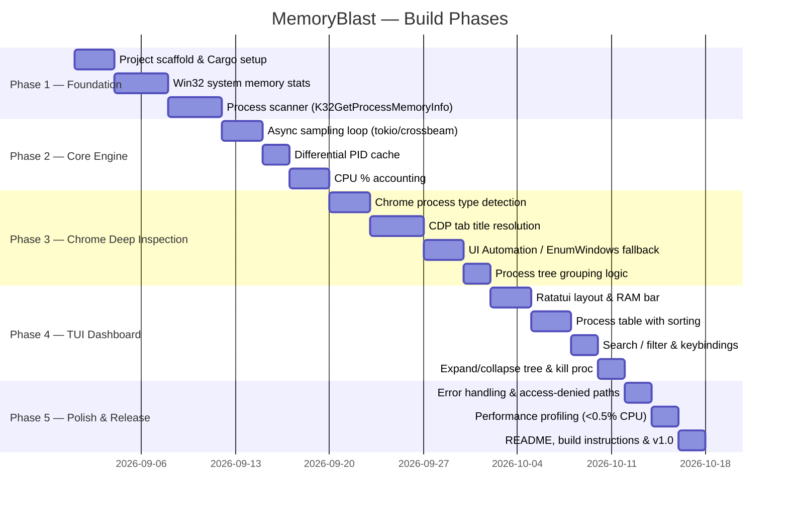

# 🚀 MemoryBlast — Development Roadmap

> High-performance Windows TUI process manager in Rust with deep Chrome tab resolution.

---

## Overview



---

## Phase 1 — Project Foundation
**Goal**: Buildable skeleton that can read system RAM and list raw processes.

| # | Task | Key APIs / Crates | Done |
|---|------|-------------------|------|
| 1.1 | Initialise `Cargo.toml` with all dependency pinning | `cargo new`, feature flags | ☐ |
| 1.2 | Module layout: `main`, `sys`, `proc`, `chrome`, `ui` | — | ☐ |
| 1.3 | Global memory stats | `GlobalMemoryStatusEx`, `NtQuerySystemInformation` | ☐ |
| 1.4 | Paged / Non-Paged pool counters | `SYSTEM_PERFORMANCE_INFORMATION` | ☐ |
| 1.5 | Process snapshot + private commit query | `K32GetProcessMemoryInfo`, `CreateToolhelp32Snapshot` | ☐ |
| 1.6 | Sort by private commit / working set | in-memory sort | ☐ |

### Crate Additions
```toml
[dependencies]
windows      = { version = "0.58", features = ["Win32_System_ProcessStatus", "Win32_System_Memory", ...] }
windows-sys  = "0.59"
sysinfo      = "0.31"
```

---

## Phase 2 — Async Sampling Engine
**Goal**: Non-blocking background loop feeding the UI thread via channels.

| # | Task | Key APIs / Crates | Done |
|---|------|-------------------|------|
| 2.1 | `tokio` multi-thread runtime setup | `tokio::spawn`, `tokio::time::interval` | ☐ |
| 2.2 | `crossbeam-channel` for UI ↔ sampler messages | `crossbeam_channel::bounded` | ☐ |
| 2.3 | Differential PID cache (re-query only on spawn) | `HashMap<u32, PidMeta>` | ☐ |
| 2.4 | CPU % calculation (delta of kernel+user times) | `GetProcessTimes` | ☐ |
| 2.5 | Configurable poll interval (500 ms default) | — | ☐ |

### Architecture Sketch

```
┌─────────────────────────────────────────┐
│              tokio runtime               │
│  ┌─────────────┐    ┌─────────────────┐ │
│  │ SamplerTask │───▶│  channel (tx)   │ │
│  └─────────────┘    └────────┬────────┘ │
│                              │          │
│                       ┌──────▼──────┐   │
│                       │  UI Thread  │   │
│                       │  (ratatui)  │   │
│                       └─────────────┘   │
└─────────────────────────────────────────┘
```

---

## Phase 3 — Chrome / Chromium Deep Inspection
**Goal**: Resolve each renderer PID → human-readable tab title.

| # | Task | Strategy | Done |
|---|------|----------|------|
| 3.1 | Detect `chrome.exe` parent & child PIDs | `sysinfo` parent_pid | ☐ |
| 3.2 | Parse `--type=` from command-line | `NtQueryInformationProcess` → `ProcessCommandLineInformation` | ☐ |
| 3.3 | **Primary**: CDP via `--remote-debugging-port` | HTTP GET `/json/list` → tab titles | ☐ |
| 3.4 | **Fallback A**: `EnumWindows` + `GetWindowTextW` | correlate HWND → PID | ☐ |
| 3.5 | **Fallback B**: UI Automation / `IAccessible` | `UIAutomationClient` COM | ☐ |
| 3.6 | Group into expandable tree node per Chrome instance | `Vec<ChromeGroup>` | ☐ |

> [!NOTE]  
> CDP requires the user to launch Chrome with `--remote-debugging-port=9222`.  
> Always fall back gracefully through strategies A → B → "Renderer (unknown)".

### Process Type Map
| `--type` value | Display Label |
|---|---|
| *(absent)* | Browser Core |
| `renderer` | Tab / Renderer |
| `gpu-process` | GPU Process |
| `utility` (network) | Network Service |
| `extension` | Extension |

---

## Phase 4 — TUI Dashboard
**Goal**: Beautiful, responsive `ratatui` terminal UI.

| # | Task | Widget | Done |
|---|------|--------|------|
| 4.1 | App event loop (key events + render tick) | `crossterm::event::poll` | ☐ |
| 4.2 | Top RAM banner (In Use / Available / Committed / Paged) | `ratatui::widgets::Gauge` | ☐ |
| 4.3 | Process table with column headers | `ratatui::widgets::Table` | ☐ |
| 4.4 | Inline Chrome sub-rows (indented tree) | custom `Table` rows | ☐ |
| 4.5 | Sort toggle: Memory ↔ CPU (`s` key) | in-place re-sort | ☐ |
| 4.6 | Search/filter bar (`/` activates, `Esc` closes) | `ratatui::widgets::Paragraph` | ☐ |
| 4.7 | Expand/Collapse Chrome tree (`Space` / `Enter`) | state bool per group | ☐ |
| 4.8 | Kill process (`k` key + confirm prompt) | `TerminateProcess` | ☐ |
| 4.9 | Refresh rate adjustment (`+` / `-`) | dynamic `Duration` | ☐ |

### Screen Layout

```
┌─ MemoryBlast ─────────────────────────────────────────────────────────────┐
│ RAM [████████████░░░░░░░░] 12.4 / 32.0 GB  Commit: 18.1/46 GB  NP: 512 MB│
├───────────────────────────────────────────────────────────────────────────┤
│  PID    Name / Tab Title              Type        Private  WorkSet  CPU%   │
│  ─────  ─────────────────────────────  ──────────  ───────  ───────  ────  │
│  4821 ▼ chrome.exe                    Browser     320 MB   480 MB   2.1%  │
│    ├─ 📄 Google – Search              Renderer    210 MB   310 MB   0.8%  │
│    ├─ 📄 GitHub – MemoryBlast         Renderer    185 MB   270 MB   0.4%  │
│    └─ ⚙️  GPU Process                 GPU         120 MB   160 MB   0.3%  │
│  1204   msedge.exe                   Browser     180 MB   240 MB   0.6%  │
│  ...                                                                      │
├───────────────────────────────────────────────────────────────────────────┤
│ [/] Search  [s] Sort  [Space] Expand  [k] Kill  [+/-] Refresh  [q] Quit  │
└───────────────────────────────────────────────────────────────────────────┘
```

---

## Phase 5 — Polish & Release
**Goal**: Robust error handling, CPU profile under 0.5%, and shipping artifacts.

| # | Task | Done |
|---|------|------|
| 5.1 | Graceful `ERROR_ACCESS_DENIED` for system processes | ☐ |
| 5.2 | `PROCESS_QUERY_LIMITED_INFORMATION` fallback for protected PIDs | ☐ |
| 5.3 | Benchmark sampling loop with `criterion` | ☐ |
| 5.4 | Confirm <0.5% CPU on idle with 300+ processes | ☐ |
| 5.5 | `README.md`: build, run, Chrome debugging setup | ☐ |
| 5.6 | GitHub Actions CI: `cargo build --release` on `windows-latest` | ☐ |
| 5.7 | Tag and release `v1.0.0` binary (`.exe`) | ☐ |

---

## Recommended Crate Manifest

```toml
[package]
name    = "memoryblast"
version = "0.1.0"
edition = "2021"

[dependencies]
# Win32 / NT APIs
windows     = { version = "0.58", features = [
    "Win32_System_ProcessStatus",
    "Win32_System_Memory",
    "Win32_System_Threading",
    "Win32_System_Diagnostics_ToolHelp",
    "Win32_System_WindowsProgramming",
    "Win32_UI_Accessibility",
    "Win32_UI_WindowsAndMessaging",
] }

# Async runtime
tokio       = { version = "1", features = ["full"] }

# Concurrency
crossbeam-channel = "0.5"
rayon             = "1"

# System info baseline
sysinfo     = "0.31"

# TUI
ratatui     = "0.27"
crossterm   = "0.27"

# HTTP for CDP
reqwest     = { version = "0.12", features = ["json"] }
serde       = { version = "1", features = ["derive"] }
serde_json  = "1"

[profile.release]
opt-level = 3
lto       = true
codegen-units = 1
strip     = true
```

---

## Milestones Summary

| Milestone | Deliverable | ETA |
|-----------|-------------|-----|
| **M1** | Reads system RAM + lists processes | Week 1 |
| **M2** | Async sampler, <0.5% CPU baseline | Week 2 |
| **M3** | Chrome tab title resolution (CDP + fallbacks) | Week 3-4 |
| **M4** | Full TUI dashboard with all keybindings | Week 5-6 |
| **M5** | v1.0.0 release binary + CI | Week 7 |

---

## Open Questions / Design Decisions

> [!IMPORTANT]
> **Admin elevation**: Some Win32 memory APIs require elevated privileges. Decide whether to embed a UAC manifest (`requireAdministrator`) or gracefully degrade for non-admin users.

> [!IMPORTANT]
> **CDP opt-in**: Tab resolution via CDP requires the user to launch Chrome with a flag. Should MemoryBlast auto-detect the flag, show a setup hint, or attempt to relaunch Chrome? 

> [!NOTE]
> **Scope**: Should other Chromium-based browsers (Edge, Brave, Arc) be supported in Phase 3, or Chrome-only for v1.0?
